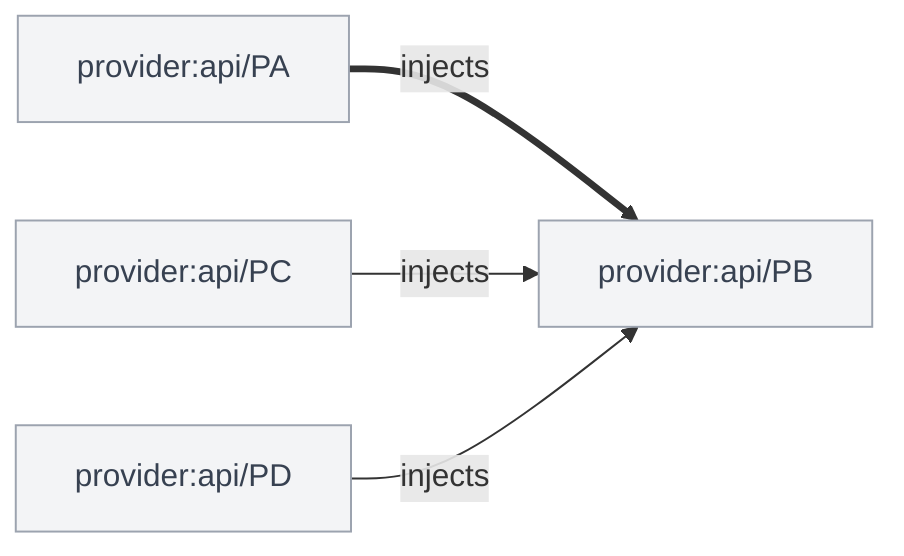

### Architecture changes

0 modules, 0 routes, +1 cross-module edge, 0 new cycles

| | Added | Removed | Changed | Moved |
|---|---:|---:|---:|---:|
| Nodes | 0 | 0 | 0 | 0 |
| Edges | 2 | 0 | 1 | - |

New cross-module edges:

- `provider:api/PC` injects `provider:api/PB`

