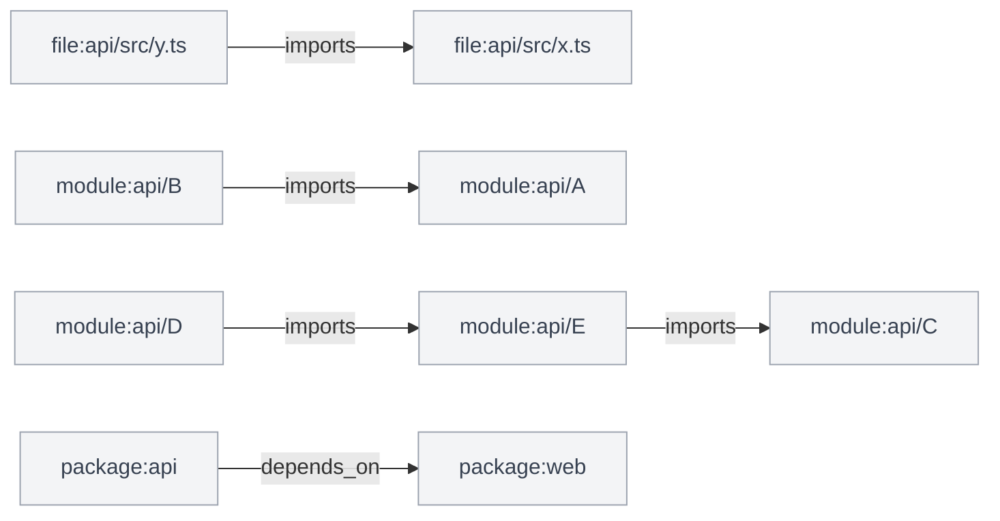

### Architecture changes

0 modules, 0 routes, 0 cross-module edges, 3 new cycles

| | Added | Removed | Changed | Moved |
|---|---:|---:|---:|---:|
| Nodes | 0 | 0 | 0 | 0 |
| Edges | 5 | 0 | 0 | - |

New cycles:

- modules: `module:api/A`, `module:api/B`
- modules: `module:api/C`, `module:api/D`, `module:api/E`
- packages: `package:api`, `package:web`

