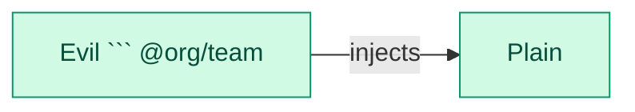

### Architecture changes

0 modules, 0 routes, +1 cross-module edge, 1 new cycle

| | Added | Removed | Changed | Moved |
|---|---:|---:|---:|---:|
| Nodes | 2 | 0 | 0 | 0 |
| Edges | 1 | 0 | 0 | - |

New cross-module edges:

- ```provider:api/E`v``il``` injects `` `Plain` ``

New cycles:

- modules: `module:api/B`, ``module:api/`A``


